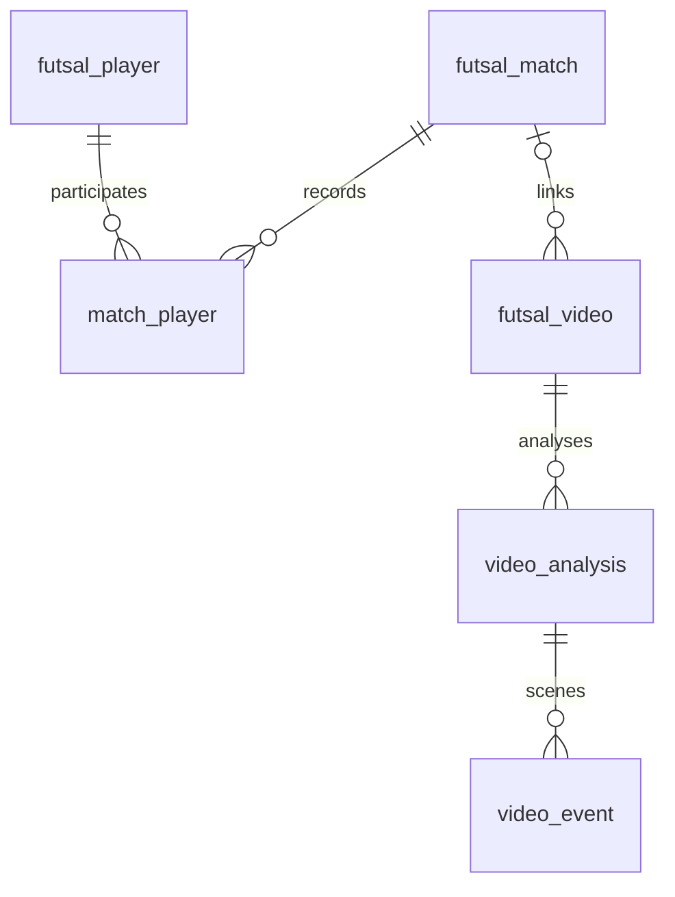

# We Go High 풋살 매치 프로젝트

기준일: 2026-10-19

서비스: https://futsal-match-theta.vercel.app/
저장소: https://github.com/YuNi-100/futsal_match

## 프로젝트 개요

여자 풋살 클럽 We Go High의 경기 결과·선수별 기록·일정·영상을 한곳에서 관리하는 웹 서비스이다. 팀 운영자는 공식 기록을 입력·관리하고, 선수는 개인 기록에서 경기 상세와 영상을 이어서 확인한다. Gemini 분석 결과는 관리자가 검수한 뒤 회원에게 시간별 피드백으로 제공한다.

초기 Node.js / Express·MySQL 구성에서 FastAPI·Supabase PostgreSQL로 전환하고 Vercel 배포를 완료하였다. 기존 MySQL 원본과 백업은 보존하며 개발 중 완성한 테스트 DB를 최종 이전 기준으로 사용하였다.

## 기능 정의서

| No. | 구분 | 기능명 | 기능 설명 | 동작 / 결과 | 상태 |
| --- | --- | --- | --- | --- | --- |
| 01 | 메인 | 홈·브랜딩 | 기존 로고·메인 사진·손글씨·색감 유지 | 홈 접속 시 팀 이미지 표시 | ✅ 완료 |
| 02 | 메인 | 경기 통계 | 전체 경기·승무패·승률·득실점 집계 | 경기 기록 변경 후 통계 반영 | ✅ 완료 |
| 03 | 메인 | 최근 경기 | 최근 5경기를 흰 카드로 표시 | 카드 전체 클릭 시 해당 경기 상세 이동 | ✅ 완료 |
| 04 | UI | 상단 메뉴 | 6개 메뉴·로그인 상태·내 페이지 | 현재 메뉴 활성화·페이지 이동 | ✅ 완료 |
| 05 | 경기 | 경기 목록 | 날짜·팀·점수·장소·결과 정렬 | 10개 단위 페이지 이동 | ✅ 완료 |
| 06 | 경기 | 기록 등록 | 날짜·상대팀·장소·점수·메모 입력 | 관리자 저장 후 DB 반영 | ✅ 완료 |
| 07 | 경기 | 참가 선수 기록 | 경기별 참가·득점·도움 입력 | 선수 누적 기록과 연결 | ✅ 완료 |
| 08 | 경기 | 기록 수정·삭제 | 관리자만 수정·삭제 허용 | 해당 경기 집계·선수 기록 갱신 | ✅ 완료 |
| 09 | 경기 | 경기 상세 | 메모·장소·선수·득점·도움·영상 표시 | 목록에서 선택한 경기 확인 | ✅ 완료 |
| 10 | 선수 | 선수 목록·카드 | 줄무늬 유니폼·등번호·이름 표시 | 카드 전체 클릭 시 선수 상세 이동 | ✅ 완료 |
| 11 | 선수 | 선수 상세 | 프로필·누적 기록·출전 경기 조회 | 경기 상세·해당 영상으로 이동 | ✅ 완료 |
| 12 | 선수 | 선수 관리 | 관리자 등록·수정·삭제 | 기록·회원 연결 선수 삭제 제한 | ✅ 완료 |
| 13 | 선수 | 회원 연결 | Google 회원과 선수 연결·변경·해제 | 선수 회원 표시·관리자 권한 별도 | ✅ 완료 |
| 14 | 일정 | 다음 경기 | 가장 가까운 일정은 큰 카드 | 이후 일정은 날짜·상대팀·장소 목록 | ✅ 완료 |
| 15 | 일정 | 시간·메모 펼치기 | 클릭한 일정 안에서 상세 표시 | 목록과 펼친 정보를 한 항목으로 표현 | ✅ 완료 |
| 16 | 일정 | 시간 입력·검증 | 24시간제·2000을 20:00으로 변환 | 종료 시간이 시작 시간보다 늦어야 저장 | ✅ 완료 |
| 17 | 일정 | 일정 관리 | 관리자 등록·수정·삭제 | 일정 정보 DB 저장·재조회 | ✅ 완료 |
| 18 | 인증 | Google 로그인 | OAuth·12시간 세션·로그아웃 | 회원 상태 유지·만료 검사 | ✅ 완료 |
| 19 | 권한 | 관리자 API 보호 | 서버 권한 검사·CSRF 검증 | 비관리자의 변경 요청 차단 | ✅ 완료 |
| 20 | 영상 | 회원 전용 시청 | 로그인 회원의 목록·임베드 재생 | 비회원 안내·영상 API 접근 차단 | ✅ 완료 |
| 21 | 영상 | 수동 영상 관리 | YouTube 링크 등록·삭제 | 중복 ID 방지·원본 YouTube는 유지 | ✅ 완료 |
| 22 | 영상 | 경기 연결 | 등록 시 선택·나중에 연결·해제 | 경기 기록과 영상 양방향 이동 | ✅ 완료 |
| 23 | AI | 분석 요청 | 등록과 분리된 Gemini 최대 30분 분석 | 관리자가 요청할 때만 실행·결과 저장 | ✅ 완료 |
| 24 | AI | 검수·게시 | 요약·시간·코멘트 편집·임시 저장 | 검수 완료 결과를 회원 화면에 게시 | ✅ 완료 |
| 25 | AI | 코멘트 시간 이동 | 시간별 코멘트와 영상 위치 연결 | 같은 화면에서 영상 이동·재생 요청 | ✅ 완료 |
| 26 | 자동화 | 영상 검색·등록 | 공개 채널 날짜·키워드 검색 | 기존 등록·삭제 이력 고려 | ✅ 완료 |
| 27 | 자동화 | 로컬 예약 | 수·토 18시 Asia/Seoul | 로컬 Codex 실행 환경 필요 | ⚙️ 로컬 구성 |
| 28 | DB | PostgreSQL 이전 | MySQL 완성 데이터를 Supabase로 이전 | 데이터 대조·기존 원본 및 백업 보존 | ✅ 완료 |
| 29 | 배포 | Vercel 배포 | FastAPI·보호 HTML·정적 자산 제공 | 운영 주소·Google 콜백 연결 | ✅ 완료 |
| 30 | UI | 반응형 | PC·태블릿·모바일 크기별 CSS | 브라우저 검증·실기기 전체 점검 남음 | ⚙️ 반영·추가 점검 |
| 31 | 후속 | 클라우드 예약 | PC와 독립된 예약·삭제 이력 영속화 | 별도 구현 필요 | ⏳ 후속 |
| 32 | 후속 | 하이라이트 제작 | 실제 영상 자동 편집·출력 | 사용량 사유로 보류 | ⏸ 보류 |

영상 수동 등록과 AI 분석은 분리한다. 등록·자동 검색만으로 유료 AI를 호출하지 않는다. 팀 공지는 현재 정적 콘텐츠이며 공지 관리 API는 구현 범위에 포함하지 않는다.

## 화면 구성과 설계

### 홈

상단 메뉴·로그인 → 기존 메인 이미지·손글씨 → 경기 통계 → 최근 경기 카드 → 다음 경기·팀 공지 → 선수 카드 순서이다. 홈의 최근 경기는 개별 흰 카드 디자인을 유지하고 전체 카드를 누르면 해당 경기 상세로 이동한다. 하단 브랜드·인스타그램 연결을 제공한다.

### 경기 기록

전용 목록은 간결한 행과 10개 단위 페이지 이동으로 구성한다. 날짜·팀·점수·장소·결과를 정렬하고 관리자 수정·삭제는 작은 텍스트로 표시한다. 상세에는 상대팀, 경기 날짜, 장소, 메모, 참가 선수와 득점·도움, 영상 연결을 제공한다. 경기 기록 등록·수정에는 시간 입력을 추가하지 않으며 일정 시간과 구분한다.

### 선수 정보

홈 선수 카드 전체와 참가 선수 이름은 선수 상세로 연결한다. 파랑·검정 줄무늬 유니폼에 등번호·이름을 표시한다. 선수 상세에서 누적 기록·출전 경기를 확인하고 경기·영상으로 이동한다. 관리자는 선수를 등록·수정하고 Google 회원과 연결할 수 있다.

### 다음 경기

가장 가까운 일정만 크게 표시한다. 이후 일정은 날짜·상대팀·장소를 간단히 보여주고 클릭하면 시간·메모를 같은 항목 안에서 펼친다. 일정은 종료 시간이 시작 시간보다 늦어야 하며 자정을 넘는 일정은 현재 입력 검증으로 지원하지 않는다.

### WGH TV·관리자 검수

회원 화면은 경기 영상 / 분석 결과 / 하이라이트 탭으로 구성한다. 하이라이트 탭은 실제 자동 제작 완료를 의미하지 않는다. 관리자 화면의 수동 등록·AI 분석·검수 목록을 분리하고 경기 연결·해제 기능은 하단에 배치한다. 검수 화면에서 요약·시간·코멘트를 수정하고 검수 완료하면 회원용 분석 결과에 게시한다. 시간 클릭 시 외부 YouTube 페이지로 나가지 않고 같은 화면의 해당 영상 위치로 이동한다.

기존 기획서에 첨부한 화면 이미지는 초기 구현 기록으로 보존한다. 최신 화면의 구조와 동작은 위 설명을 기준으로 한다.

## 화면 사진 자료

아래 사진은 사용자가 제공한 Notion 내보내기 원본입니다. **초기 개발 화면**이므로 사이드바·원형 등번호 등은 현재 상단 메뉴·유니폼 카드와 다릅니다. 사진은 디자인 변화의 기록으로 사용하고, 현재 동작은 위 기능 정의서를 기준으로 확인합니다.

### 홈과 팀 브랜딩

기존 팀 이미지·색감을 유지하고 상단 메뉴로 개편했습니다. 홈 배치는 메인 이미지 → 통계 → 최근 경기 → 다음 경기·공지 → 선수 카드입니다.

### 최근 경기 · 다음 경기

홈의 흰 경기 카드 디자인은 유지합니다. 별도 경기 목록은 10개 단위이며, 다음 경기 전용 화면은 가장 가까운 일정만 큰 카드로 표시합니다.

### 경기 기록 등록 · 일정 등록

| 경기 기록 등록 — 초기 화면 | 일정 등록 — 초기 화면 |
| --- | --- |
|  |  |

경기 기록은 날짜·상대팀·점수·메모·참가 선수 기록·영상 연결을 관리합니다. 시작·종료 시간은 일정 등록에서 입력하며 두 입력 흐름을 구분합니다.

### 선수 정보

현재는 원형 등번호 대신 파랑·검정 줄무늬 유니폼에 등번호·이름을 표시하며 선수 상세와 경기·영상 기록으로 연결합니다.

### DB 설계의 변화

이 이미지는 선수·경기를 독립 관리하던 **초기 설계 자료**입니다. 현재 관계는 아래와 같으며 실제 스키마는 [PostgreSQL SQL](migrations/postgresql/001_wgh_schema.sql)을 기준으로 합니다.

## DB 설계

현재 Supabase PostgreSQL의 wgh 스키마를 사용한다. PK·FK를 통해 경기, 선수, 영상, 분석과 회원 정보를 연결한다. 초기 문서의 ‘선수와 경기는 독립적이며 FK 미구현’ 상태는 현재 구현으로 대체한다.

| 테이블 | 역할 |
| --- | --- |
| app_user | 회원 |
| futsal_player | 선수 기본 정보 |
| futsal_match | 완료 경기 결과 |
| match_player | 경기·선수 연결, 참가 및 득점·도움 |
| futsal_schedule | 다음 경기 일정과 시간·메모 |
| futsal_video | YouTube 메타데이터·경기 연결 |
| video_analysis / video_event | 분석 결과와 장면 정보 |
| wgh_google_identity / wgh_user_role | Google 식별자·역할 |
| wgh_login_session / wgh_oauth_state | 서버 세션·OAuth 요청 검증 |
| wgh_account_consent / wgh_admin_request / wgh_role_history | 동의·관리자 신청·권한 이력 |
| wgh_player_account | 선수와 회원 연결 |
| player | 이전 데이터 보존용 구 테이블 |

선수 1:N match_player N:1 경기 관계로 경기별 기록과 선수 누적 기록을 연결한다. 영상은 선택적으로 경기를 참조한다. 경기 삭제 시 해당 참가 기록은 제거되고 영상의 경기 연결은 해제된다. 홈페이지 영상 삭제는 경기 결과·선수 기록과 YouTube 원본을 삭제하지 않는다. 영상 종속 분석 자료는 함께 제거된다. 기록·회원 연결이 있는 선수의 삭제는 제한한다.

DB 접속은 서버에서 처리하고 브라우저에 접속 비밀번호를 노출하지 않는다. RLS·접근 권한 제한을 적용하며 Supabase Auth 대신 Google OAuth·서버 세션을 사용한다. 이전 스냅샷은 17개 테이블·영속 데이터 70개 행이며 세션은 이전하지 않았다. 이는 현재 운영 행 수를 뜻하지 않는다.

## 데이터 수집과 활용

공식 경기 결과·참가 선수·득점·도움·일정은 실제 팀 활동 기록을 바탕으로 관리자가 입력한다. 팀 촬영·제작 이미지는 브랜딩에 활용한다. 영상 원본은 YouTube에 보관하고 홈페이지에는 링크와 메타데이터를 저장한다.

공개 채널 @yuni_andv5909의 제목에 실제 경기 날짜와 WGH·은평·친선경기 등 조건을 사용한다. 날짜는 경기 날짜로 저장하고 화면 제목에서 분리하여 중복 표시를 줄인다. 수동 등록한 ID는 중복 등록하지 않으며 삭제 영상 재등록 방지 상태를 보관한다. 공개 피드 범위의 검색이라 전체 과거 영상 수집을 보장하지 않는다. 일부공개 영상은 링크로 수동 등록하고, 현재 AI 분석은 공개 영상을 전제로 한다.

AI 코멘트는 관리자가 검수하는 복기 자료로 사용하며 공식 경기 결과나 선수 득점·도움을 자동 변경하지 않는다. 모델 접근 권한·영상 상태·사용량에 따라 분석이 실패할 수 있고 API 비용이 발생한다.

## 개발환경·배포·검증

| 구분 | 현재 기술 |
| --- | --- |
| 개발 도구 | Visual Studio Code, Git·GitHub |
| 화면 | HTML5·CSS3·JavaScript |
| 서버 | Python 3.14·FastAPI·Uvicorn·Pydantic |
| 데이터베이스 | Supabase PostgreSQL·psycopg |
| 인증 | Google OAuth·서버 쿠키 세션·CSRF |
| 분석 | Google Gen AI SDK·Gemini |
| 영상 | YouTube 링크·임베드 |
| 배포 | Vercel·build_vercel.py·uv.lock |
| 비밀 설정 | 로컬 비공개 .env·Vercel 서버 환경변수 |

브라우저 → Vercel FastAPI → Supabase PostgreSQL 구조이다. 기존 MySQL 연결·원본·백업은 복구용으로 보존한다. OpenAI 기사 초안과 기존 로컬 영상 API는 별도 시범 코드로 남아 있으며 핵심 완료 기능과 구분한다.

기존 검증 기록은 단위 테스트 118개 중 112개 통과·선택 DB 테스트 6개 제외이다. PostgreSQL 인증·CRUD·영상 연결은 격리된 임시 스키마에서 검증했고, 화면 크기별 브라우저 검증을 수행하였다. 실제 기기 전체 점검·운영 환경 AI 호출 검증과 같은 범위로 표현하지 않는다.

## 남은 작업

- 로컬 예약 검색을 클라우드 예약으로 이전하고 삭제 이력을 영속화
- 실제 하이라이트 영상 제작
- 배포본 PC·태블릿·스마트폰 실기기 전체 점검

Google 로그인, 관리자 기록 관리, 경기·선수·영상 연결, AI 검수·게시, 디자인 반영, PostgreSQL 이전·Vercel 배포는 구현 완료로 정리한다.
